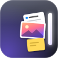

# Ledge · 搁这儿



**看中的东西，先搁这儿。**

Ledge 是一个贴在 macOS 屏幕边缘的材料暂存区。把文件、图片、文字和网址放进来，整理、预览或就地处理，再拖到需要它们的应用中。用完清空，不做项目进度管理。

中文系统显示「搁这儿」，其他语言显示「Ledge」。当前为 **0.1.0 开发版**，公开源码采用 [MIT 许可证](LICENSE)。本仓库暂不提供经过 Apple 公证的安装包。

## 能做什么

- **随手收纳**：拖入文件和普通文件夹，主动粘贴文字、图片或网址。收纳文件时保存副本，保留原件。
- **自由整理**：多个收集区、二维画布、缩放、框选、多选移动、卡片尺寸和堆叠。
- **交给其他工具**：拖出或复制选中材料；按收集区分组导出。接收方可以选择文件、文字或网址格式。
- **预览与处理**：系统 Quick Look、网页截图缓存、本地图片压缩／缩放／PNG 与 JPEG 转换、OCR。
- **可选文字 AI**：通过已有 Codex／ChatGPT 登录进行解释、翻译、总结、润色、改写及追问。AI 开关不影响本地图片处理。
- **桌面入口**：右侧、左侧或上方停靠，默认全局快捷键 `⌃⌥D`；菜单栏、设置、关于和可重看的六步新手引导。
- **删除与撤销**：清空材料、批量删除收集区、保留一次撤销；超过撤销期限后回收副本文件。

## 环境要求

- macOS 14 或更新版本；当前构建脚本面向 **Apple Silicon（arm64）**。
- 提供 Swift 6 的 Xcode Command Line Tools，可通过 `xcrun swiftc --version` 检查。
- 应用使用 AppKit、SwiftUI、Vision、WebKit 等系统框架，常规构建无需安装第三方运行库。
- 文字 AI 另需本机已有可用的 Codex／ChatGPT 登录。当前服务适配 `/Applications/ChatGPT.app` 内的 Codex CLI 路径；该路径或上游协议变化时可能需要更新适配。没有此依赖仍可使用本地收纳、整理和图片处理功能。

## 构建与运行

```sh
git clone https://github.com/abelguan02/Ledge.git
cd Ledge
bash app/build.sh
open app/build/Ledge.app
```

构建产物是 `app/build/Ledge.app`。脚本不会自动打开应用，使用本地 ad-hoc 签名并校验内嵌 XPC 服务。它不等同于 Developer ID 签名和 Apple 公证发行包。

可以使用其他构建目录，避免覆盖正在使用的包：

```sh
LEDGE_BUILD_ROOT=/tmp/ledge-build bash app/build.sh
```

修改正在使用的版本前先正常退出应用，避免覆盖运行中的程序。

## 开始使用

1. 首次启动，通过系统文件夹选择器授权用户的 `Library/Application Support`，创建或打开 Ledge 数据目录。
2. 点击屏幕边缘的停靠条，或按 `⌃⌥D` 展开。拖着文件靠近停靠条也可打开投放面板。
3. 拖入材料，或在画布中按 `⌘V` 主动粘贴。点击空白处取消选择，拖动空白处框选；`Shift` 追加、`⌘` 增减选中。
4. 拖动材料调整位置；向外拖出或按 `⌘C` 复制。轻按空格用系统预览，双击打开材料；按住空格拖动可平移画布。
5. 点击收集区名称切换、新建或管理收集区；删除前可导出，删除后可撤销一次，下一次删除或正常退出会结束该撤销机会。

菜单栏的「设置…」可调整停靠位置、快捷键、容量限制、AI 和自动网页截图。快捷键录制可能需要辅助功能授权，应用会在主动录制时提示；取消授权会保留原快捷键。

「关于 → 重新观看新手引导」可以再次进入示例引导。示例只在临时内存画布中，不读剪贴板、不申请权限、不联网，结束后清理。赞赏页展示作者提供的收款码，完全自愿，不影响功能。

关于页的「开源仓库」打开本仓库，「反馈与建议」打开新建 Issue 页面。「检查更新」手动查询 GitHub 最新正式 Release：有新版时打开对应发布页，没有正式发布时显示「暂无正式发布」。不会自动下载或安装。

## 数据与联网边界

- 应用身份：`local.ledge.desktop`。数据目录：`~/Library/Application Support/Ledge`，通过沙盒目录授权访问。
- 从旧 Dump 迁移时只复制，不删除旧目录；校验收集区、材料数量、索引和文件哈希。已有目标库不会被覆盖。外部原件的旧授权失效时，可能需要重新定位。
- 只有用户主动粘贴时才读取剪贴板。新手引导不读取拖入文件的内容。
- 文字 AI 会把所选文字发送给已连接的服务；关闭后不再发送后续排队请求，已发送的请求可以完成。客户端禁用工具、MCP 和网页搜索；无法可靠识别的 MCP 配置会明确拒绝启动。
- 网页自动截图会访问网址，可在设置中关闭；手动生成或刷新仍会访问对应页面。没有截图的网址在 Quick Look 中展示本地说明，避免预览原链接触发请求。
- 普通本地图片转换、OCR 和文件整理无需 AI 账号。仓库中不包含作者的材料库、账号凭据、迁移审计、回退应用包或本机验收截图。
- 只有点击「检查更新」才访问公开 GitHub Releases API，不携带账号凭据、Cookie 或材料内容；打开关于页不触发查询。

## 开发与测试

| 目录 | 内容 |
| --- | --- |
| `app/Sources/Core/` | 材料模型、存储、迁移、布局和设置 |
| `app/Sources/Services/` | Codex 通信、媒体、OCR、拖放和网页预览 |
| `app/Sources/UI/` | 原生窗口、菜单、画布与引导 |
| `app/Service/` | Codex XPC 服务与启动约束 |
| `app/Tests/`、`app/Tools/` | 合成数据回归、诊断和开发工具 |
| `app/Resources/` | 应用图标、菜单栏图标、本地化名称与收款码 |
| `design/` | SVG 图标源文件与设计画板源码 |
| `docs/` | [产品简报](docs/PRODUCT_BRIEF.md)与[概念设计规格](docs/CONCEPT_SPEC.md) |

常用后台检查：

```sh
bash app/test.sh
bash app/test-services.sh
bash app/test-storage.sh
bash app/test-recovery.sh
bash app/test-migration.sh
bash app/test-model.sh
bash app/test-collections.sh
bash app/test-collection-model.sh
bash app/test-settings.sh
bash app/test-presentation.sh
bash app/test-updates.sh
bash app/test-coffee.sh
```

更多专项脚本见 `app/test-*.sh`。数据回归使用隔离合成目录，AI 通信回归使用假后端；收款码回归直接离屏渲染生产组件，比较二维码内容。部分测试需要 macOS 窗口服务、Vision 或独立测试粘贴板，严格的外层命令沙盒可能阻止这些系统能力。

外观定义集中在 `app/Sources/UI/LedgeSkin.swift`、`SkinSurfaces.swift` 与 `SkinTypography.swift`。设置“通用”第一行提供经典／初号机切换，默认经典，选择会保存并立即更新应用界面。`SkinRoot` 将同一偏好传给各窗口、独立画布宿主和收集区弹出层；切换不重建画布，不持有或重置材料、堆叠、视口和撤销状态。系统菜单、Quick Look、文件选择器和授权对话框不接入皮肤环境。

初号机目前是开发中的基础样式：固定深色、紫绿配色、切角外壳、装甲条、刻度尺、直角控件底形与静态扫描线。逐屏布局、图片压色与专属动效尚未完成，不能当作完整皮肤交付。扫描线仅用于显示，不进入材料文件和导出内容；赞赏二维码及白底区域不叠加扫描线。应用窗口标题栏随初号机固定深色，返回经典后恢复原有外观继承。大字使用从 Noto Serif SC Black 生成并改名的字符子集，许可与来源见 [字体说明](app/Resources/Fonts/NOTICE.md)；用户自定义名称优先回退至系统宋体，宋体也缺字时由系统补齐。“全部”“清空”“搁这儿”保留字形替换入口，当前使用程序处理。

`bash app/test-skin.sh /绝对路径/改动前的Sources` 会用相同合成状态离屏渲染改动前后两版，并比较 292 张深浅色、1×/2× 组件图像。比较检查尺寸和像素；仅容许同一基线重复渲染实测的每通道 1/255 边缘取整波动。图像和日志留在临时目录。此测试不能验证窗口玻璃合成、动态过程及离屏渲染器不支持的原生控件，这些仍须前台单独验收。

与没有皮肤入口的旧版比较时，可追加 `--new-skin-selector`：明确排除 4 张有意变化的通用设置图，其余 288 张仍严格比较。`bash app/test-skin-switch.sh` 用隐藏的生产画布和回答编辑器检查切换时的实例、输入、焦点、堆叠、视口与确认状态，并检查原生标题栏深浅色恢复、独立文件选择器的系统外观，以及完整赞赏页在 1×/2× 下的二维码解码与白边像素；离屏检查三侧切角、固定深色、字体回退和两套通用设置。偏好持久化、处理中切换及撤销保留另由 `app/test-settings.sh` 覆盖。

`bash app/build-skin-review.sh [Sources绝对路径] [输出目录]` 只构建隔离验收程序，不启动它。程序复用生产窗口和组件，使用临时合成库、假 AI 后端及不注册全局快捷键的测试实现；显式传入 `--show` 才显示界面。开始前仍须取得当时的前台空闲确认，验收中不操作登录启动、系统授权或外部链接。

经典皮肤抽取已通过上述离屏比较及代表场景的真实窗口检查，包括玻璃、原生设置控件、清空确认和引导；未做全部动画状态的逐帧比较，也未实测系统“减少动态效果”开关。基础皮肤切换、窗口同步及三侧外壳已做隔离合成数据前台抽查；发现的二维码扫描线和浅色标题栏问题已修复，并通过后台回归及修复后的实际界面定点复验。前台抽查与离屏像素比较分别记录，不能互相替代。

`app/Tools/UIProbe.swift` 等前台工具只供明确授权后的界面验收，不能与无窗口回归混用。构建缓存和测试产物可以重新生成，不应提交到仓库。

设计画板 `.dc.html` 来自设计画布环境，仓库保留它们用于读取尺寸、颜色、文字和动画参数；不是可独立运行的网页应用。

## 当前限制

- 暂无 Windows 或 Intel 构建配置；多屏、全屏和第三方文件承诺仍有未全面验证的兼容场景。
- 本地图片转换面向单帧 PNG／JPEG；视频／音频转换、转写和网页正文总结未实现。
- 收纳目录不接受符号链接和特殊文件，不接受包含应用自身材料库的目录。
- 网页截图可能受网站访问限制影响，失败时会保留材料及已有缓存，不承诺绕过访问限制。
- 更新检查只识别正式 Release 的数字版本标签（如 `v0.1.1` 或 `0.1.1`，一至三段），与应用的 `CFBundleShortVersionString` 比较；草稿和预发布不作为更新。尚未提供自动下载安装。
- `local.*` 身份与本地签名用于当前开发阶段，正式分发的签名、公证和安装流程尚未提供。

## 许可

[MIT License](LICENSE) · Copyright © 2026 abelguan02
